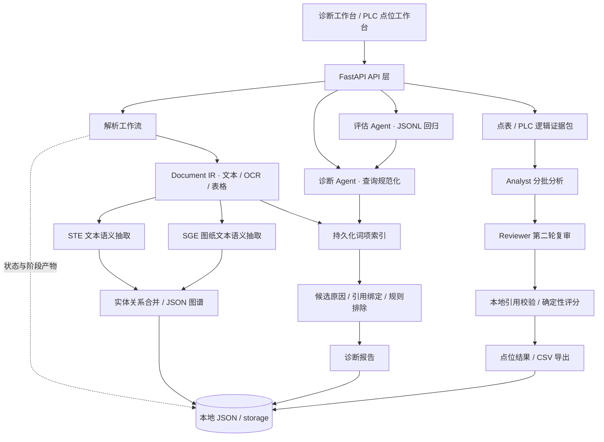

# 工业智能维保多 Agent 诊断平台

<div align="center">

Industrial Maintenance Multi-Agent Diagnosis Platform

从设备资料到故障假设，让每条诊断建议都有证据，让每个处理阶段都有可检查的产物。


[](https://github.com/rryyyi/Agent-project-2/actions/workflows/repository-checks.yml)

[快速开始](#快速开始) · [系统架构](#系统架构) · [工程设计](docs/architecture.md) · [点位分析](POINT_ANALYSIS.md) · [演示资料](examples/README.md)

</div>

## 项目概览

工业维保的难点在于连接分散的证据：设备手册描述故障现象，图纸记录接线与地址，点位表标识信号，PLC 程序体现联锁关系。现场人员需要把这些信息组织成可以逐项验证的故障假设。

本项目围绕 **“资料解析 → 知识构建 → 诊断问答 → 质量评估”** 构建多 Agent 工作流，提供文档诊断工作台与 PLC 点位重要性分析工作台。系统将非结构化资料转换为统一 Document IR，保留页码和坐标，构建设备实体关系与检索索引；在诊断中返回候选原因、证据引用和验证步骤，在点位分析中通过分析、复审和本地规则共同约束结论。

**项目定位：** 可运行的工程原型，用于展示 Agent 编排、工业异构数据处理、证据约束与评估闭环。当前采用 FastAPI 进程内任务和本地 JSON 持久化，适合单实例演示与工程验证。

| 使用场景 | 输入 | 输出 |
| --- | --- | --- |
| 设备资料建库 | PDF、图纸图片、DOCX、XLSX、可读工程导出 ZIP | Document IR、实体关系、图谱、检索索引、任务状态 |
| 维保辅助诊断 | 故障现象、设备标识、已建立的知识库 | 排序候选原因、来源片段、页码、验证步骤、诊断报告 |
| PLC 关键点位分析 | CSV 点位表 + SCL/AWL/STL/可读 XML 逻辑 | 重要性分数、证据等级、审查状态、引用详情、CSV 报告 |
| 回归评估 | JSONL 用例 | 命中指标、失败案例、改进建议、落盘报告 |

## 核心工程能力

### 1. Harness：显式阶段、状态持久化与产物追踪

解析编排由明确的阶段推进，而不是一次不可观测的长模型调用：文件识别、文本提取、文本语义抽取、图形语义抽取、图谱构建。每次状态更新记录 `task_id / document_id / status / stage / progress / updated_at / artifacts`；IR、抽取结果、图谱分别持久化，失败记录保留错误信息和已产生的中间结果。

这为故障定位和未来的 Checkpoint 恢复提供基础。**当前实现的是阶段状态与产物落盘，自动从断点续跑、局部重试调度、事务回滚和完整事件 Trace 属于后续演进项。** 详见 [工作流与可靠性边界](docs/architecture.md#工作流与可靠性边界)。

### 2. 多模态异构资料 → 统一 Document IR

PDF 文本层与扫描页 OCR、图纸图片、Word 表格和 Excel 工作表汇入统一的 `blocks / images / metadata` 结构。PDF/图片保留 `page`、`bbox`，文档解析与下游检索通过中间表示解耦；STE（文本语义抽取）与 SGE（图纸 OCR 文本语义抽取）分别识别设备、部件、故障码、PLC 地址及关系，再合并成 JSON 图谱。

图纸目前通过图片或 PDF 导出接入；原生 DWG/DXF 解析与 PLC 在线时序采集尚未接入。点位分析处理的是点表和可读程序逻辑，运行点值快照另有内部存储接口。

### 3. Grounding：诊断证据与不确定性表达

诊断链路先规范化故障用语并生成检索变体，再通过轻量词项检索获得证据，返回 `source_id / quote / page / location / score`，结合内部运行点值进行简单规则排除。候选结果包含 `possibility`、`status`、`rationale` 和 `verification_steps`；知识不足时明确返回补充资料的建议。

当前诊断引用采用词项匹配绑定，`possibility` 是模型或启发式分数，尚未做概率校准。强度更高的原文校验与复审门槛已在 PLC 点位分析链路中实现。

### 4. Analyst → Reviewer → Deterministic Validator

点位分析把模型推理与最终判定拆开：

1. **Analyst：** 分批分析点位，输出逻辑引用、下游影响、运行门槛与反事实场景。
2. **Reviewer：** 通过第二轮模型调用审查草稿，修正不受文件支持的推断；这是独立审查角色，不代表使用不同模型或统计独立。
3. **Validator：** 本地检查点位身份、来源路径与引用原文，确定性计算分数，再依据门槛判定“已验证”或候选状态。

即使分数很高，缺少复审、逻辑路径、反事实变化或有效引用，也不能标记为“已验证”。原文存在性校验与评分门槛可直接通过 [服务实现](services/point_analysis_service.py) 和 [测试用例](tests/test_point_analysis.py) 审查。

## 系统架构



图谱当前是可查询、可展示的建库产物；诊断检索尚未使用图遍历。Embedding/Rerank 客户端已封装，尚未接入当前词项检索主链路。模型配置、调用差异与可用性边界见 [模型服务说明](MODEL_SERVICES.md)。

## 快速开始

### 环境准备

源码使用 Python 3.10+ 语法，建议使用 **Python 3.11** 创建环境，以便匹配 PaddleOCR/PaddlePaddle 的安装支持。OCR 依赖需要根据操作系统和计算平台选择兼容版本；默认安装清单尚未锁定版本，完整环境验证应保留实际依赖版本。

```bash
git clone https://github.com/rryyyi/Agent-project-2.git
cd Agent-project-2
python -m venv .venv
```

激活环境：

```powershell
# Windows PowerShell
.\.venv\Scripts\Activate.ps1
Copy-Item .env.example .env
```

```bash
# macOS / Linux
source .venv/bin/activate
cp .env.example .env
```

```bash
python -m pip install -r requirements.txt
```

### 配置模型并启动

在 `.env` 中填写自己的服务凭证，并确认账户支持所选模型：

```dotenv
SILICONFLOW_API_KEY=your-api-key
SILICONFLOW_BASE_URL=https://api.siliconflow.cn/v1
CHAT_MODEL=Qwen/Qwen3.5-9B
POINT_ANALYSIS_MODEL=Qwen/Qwen3.5-9B
POINT_ANALYSIS_BATCH_SIZE=12
POINT_ANALYSIS_MAX_BUNDLE_CHARS=60000
MODEL_TIMEOUT=180
```

```bash
python -m uvicorn main:app --host 127.0.0.1 --port 8000
```

| 地址 | 用途 |
| --- | --- |
| <http://127.0.0.1:8000/> | 文档上传、解析状态、图谱、诊断与评估工作台 |
| <http://127.0.0.1:8000/point-analysis> | PLC 点位分析、筛选、证据详情与 CSV 导出 |
| <http://127.0.0.1:8000/docs> | OpenAPI 交互文档 |
| <http://127.0.0.1:8000/health> | 进程存活检查；不代表模型/OCR 已就绪 |

点位分析使用带 API Key 的模型客户端，缺少凭证或模型调用失败时记录任务失败。旧版 STE/SGE 与诊断链路仍保留规则降级，详见 [模型调用行为](MODEL_SERVICES.md#当前调用行为)。诊断工作台样式使用 Tailwind CDN，隔离网络环境需额外处理该前端依赖。

## 复现一次完整流程

### 文档诊断

1. 上传设备手册 PDF 或支持的资料，取得 `document_id` 与 `parse_task_id`。
2. 轮询任务接口，观察 `parsing → extracting → completed / failed`；在文档详情查看 IR、抽取结果和图谱。
3. 输入故障现象；检查候选原因、引用页码及验证步骤，对照原始资料逐项确认。
4. 运行评估，查看 `storage/reports/` 中的诊断与评估 JSON。

以下示例使用 Bash；PowerShell 中可使用 `curl.exe`，或直接在 `/docs` 操作：

```bash
curl -X POST http://127.0.0.1:8000/api/v1/upload/ \
  -F 'file=@manual.pdf' -F 'device_id=CRANE-01' -F 'doc_type=manual'

curl http://127.0.0.1:8000/api/v1/parse/tasks/YOUR_TASK_ID

curl -X POST http://127.0.0.1:8000/api/v1/diagnosis/ \
  -H 'Content-Type: application/json' \
  -d '{"symptom":"起升电机无法启动","device_id":"CRANE-01","top_k":5}'

curl -X POST http://127.0.0.1:8000/api/v1/evaluation/run \
  -H 'Content-Type: application/json' -d '{}'
```

`manual.pdf` 为自行准备的设备资料，仓库不包含真实设备手册。当前索引为全局索引，`device_id` 用于读取内部运行快照，尚不承担文档隔离过滤。

### PLC 点位分析

仓库提供 [合成演示点表与 SCL 逻辑](examples/README.md)，可直接在点位工作台同时上传：

```bash
curl -X POST http://127.0.0.1:8000/api/v1/point-analysis/runs \
  -F 'files=@examples/plc/points.csv' \
  -F 'files=@examples/plc/logic.scl'
```

该接口返回 HTTP `202` 和 `run_id`；随后查询状态、分页结果或下载 CSV。实际模型输出可能不同，示例不预设“已验证”结果。它展示如何从原始点位追溯程序文本证据，不执行 PLC 程序，也不连接控制器。

## API 速查

| 方法 | 路径 | 功能 |
| --- | --- | --- |
| `POST` | `/api/v1/upload/` | 流式上传资料并创建解析任务 |
| `GET` | `/api/v1/parse/tasks/{task_id}` | 阶段、进度、错误与产物路径 |
| `GET` | `/api/v1/documents/` | 文档列表 |
| `GET` | `/api/v1/documents/{document_id}` | 元数据与产物清单 |
| `GET` | `/api/v1/documents/{document_id}/ir` | 统一中间表示 |
| `GET` | `/api/v1/documents/{document_id}/ste` | 文本语义抽取结果 |
| `GET` | `/api/v1/documents/{document_id}/sge` | 图形语义抽取结果 |
| `GET` | `/api/v1/documents/{document_id}/graph` | 实体关系图谱 |
| `POST` | `/api/v1/diagnosis/` | 证据辅助诊断 |
| `POST` | `/api/v1/evaluation/run` | JSONL 评估 |
| `POST` | `/api/v1/point-analysis/runs` | 创建点位分析任务 |
| `GET` | `/api/v1/point-analysis/runs/{run_id}` | 点位任务状态 |
| `GET` | `/api/v1/point-analysis/runs/{run_id}/results` | 分页、状态筛选与搜索 |
| `GET` | `/api/v1/point-analysis/runs/{run_id}/download` | 导出分析 CSV |

## 代码导航

```text
.
├── main.py                       # FastAPI 入口与工作台页面
├── config.py                     # 环境变量、模型与存储目录
├── routers/                      # 上传 / 解析 / 文档 / 诊断 / 评估 / 点位 API
├── models/schemas.py              # 任务、诊断、证据与评估数据契约
├── services/
│   ├── parse_service.py          # 阶段编排、状态与产物落盘
│   ├── extractor_*.py            # PDF / OCR / Word / Excel / 工程包
│   ├── ste_service.py            # 文本实体关系抽取
│   ├── sge_service.py            # OCR 文本的图形语义抽取
│   ├── graph_builder.py          # 多来源实体关系合并
│   ├── index_service.py          # 词项检索与运行点值内部适配
│   ├── diagnosis_service.py      # 查询变体、候选原因、引用与排除规则
│   ├── evaluation_service.py     # JSONL 回归与报告
│   ├── point_analysis_service.py # 分析 / 复审 / 引用校验 / 评分
│   ├── siliconflow_client.py     # 认证、超时与传输错误重试
│   └── storage_service.py        # 文档产物与任务持久化
├── frontend/                     # 诊断工作台、点位工作台
├── examples/plc/                  # 可公开的合成演示资料
├── tests/                        # 点位测试与诊断 smoke 数据
├── docs/architecture.md           # 工程取舍、状态与可靠性边界
└── .github/workflows/             # Markdown 与 Python 语法检查
```

运行时 `storage/` 按 `originals / parsed / extracted / graph / meta / tasks / index / reports / point-analysis` 保存产物，已从版本管理中排除。

## 测试与评估

安装运行依赖后执行现有测试：

```bash
python -m pip install -r requirements-dev.txt
python -m pytest -q
```

当前自动化测试覆盖：评分验证门槛、来源路径和引用原文检查、上传路径限制、任务 API、结果分页与筛选、CSV 下载。接口测试通过替代模型分析隔离外部服务，**不验证真实模型效果或 OCR 质量**。GitHub Actions 单独执行 Markdown 与 Python 语法检查，不将其标记为业务测试。

诊断评估默认使用 [JSONL smoke 数据](tests/data/diagnosis.jsonl)，当前仅两条案例：

| 指标 | 当前实现口径 |
| --- | --- |
| `case_count` | 读取到的测试案例数量 |
| `diagnosis_recall` | 预期关键词在候选原因中至少命中一个的案例比例 |
| `evidence_grounding` | 当前仅统计最后一个案例中带证据的候选比例，尚非全数据集溯源正确率 |

这些指标用于流程回归，不构成工业诊断准确率基准。扩展评估应固定资料版本、模型版本与参数，增加引用正确性、证据覆盖、拒答质量、故障恢复和端到端延迟，并保留原始报告。

## 工程取舍与演进方向

| 领域 | 当前实现 | 下一步 |
| --- | --- | --- |
| Harness | 顺序阶段编排、状态快照、中间产物持久化 | 持久化任务队列、Checkpoint 恢复、幂等节点、局部重试与事件 Trace |
| 检索 | 查询规范化、词项召回、JSON 图谱构建 | 接入 Embedding/Rerank、图检索、按设备过滤 |
| Grounding | 诊断引用绑定；点位双轮审查和本地原文校验 | 引用位置精确解析、语义支持度校验、置信度校准 |
| 工业接入 | 文档、OCR、表格、点表与可读 PLC 逻辑 | CAD 原生解析、带时间戳/质量码的 PLC 时序适配 |
| 质量闭环 | 两条诊断 smoke 用例、点位规则/API 测试 | 分层标注集、故障注入、完整 OCR/模型端到端回归 |
| 服务化 | 单实例、本地 JSON、无鉴权 API | 鉴权、输入边界加固、并发安全存储、队列与指标监控 |

## 项目资料与维护

- [架构与可靠性设计](docs/architecture.md)：状态流、数据契约、证据门槛和实现边界。
- [模型服务配置](MODEL_SERVICES.md)：当前配置、调用行为与历史本地脚本说明。
- [工业点位分析](POINT_ANALYSIS.md)：分析输入、输出与 API。
- [贡献与验证规范](CONTRIBUTING.md)：开发检查和提交要求。
- [变更记录](CHANGELOG.md)：仓库维护记录。
- [本次验证记录](docs/verification.md)：已执行检查、环境限制与未验证范围。

项目公开内容不包含真实生产点表、设备凭证或客户手册；提交演示资料时请使用合成或已获授权的数据。仓库暂未声明开源许可证，使用与分发权限以作者后续声明为准。
