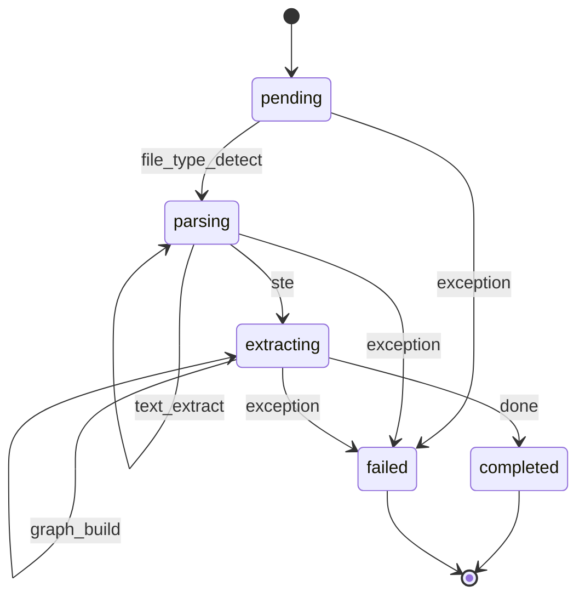
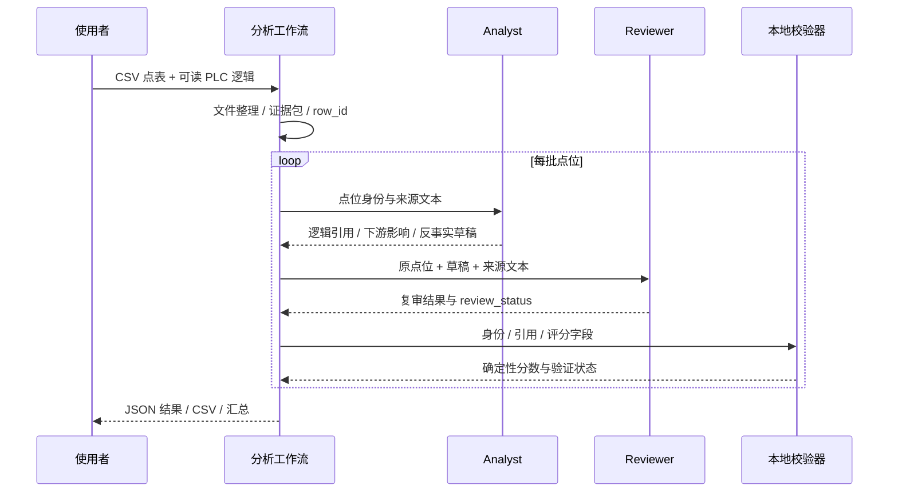

# 架构与可靠性设计

本文对应当前仓库实现，说明 Agent 职责、数据流、状态管理和结论验证方式。可从 [README](../README.md) 进入运行流程。

## Agent 职责与编排

系统采用职责明确的服务节点协作：解析节点生成结构化资料，知识构建节点抽取实体与关系，诊断节点组织故障假设，评估节点消费回归数据。当前由 Python 函数和 FastAPI `BackgroundTasks` 编排；“多 Agent”指分工与模型角色，不意味着各节点均是自主循环的独立进程。

| 节点 | 输入 | 产物 | 代码入口 |
| --- | --- | --- | --- |
| 资料解析 | 文件路径、格式 | Document IR、文本块、OCR 文本 | `services/parse_service.py`、`services/extractor_*.py` |
| 知识构建 | 文本、图纸 OCR 文本、上下文 | STE/SGE JSON、实体关系图谱 | `services/ste_service.py`、`services/sge_service.py`、`services/graph_builder.py` |
| 诊断问答 | 症状、设备标识、检索片段 | 候选原因、引用、验证步骤 | `services/diagnosis_service.py` |
| 质量评估 | JSONL 案例 | 关键词命中、失败案例、报告 | `services/evaluation_service.py` |
| 点位分析 | 点表、可读逻辑证据包 | 分析草稿、复审结果、评分与报告 | `services/point_analysis_service.py` |

知识图谱存储 STE/SGE 实体与关系并供前端查询；诊断当前直接检索 IR 文本索引，不读取图谱进行多跳推理。SGE 接收 OCR 文本和上下文，不直接向视觉模型发送原始图像。

## 工作流与可靠性边界

解析流程通过 `_update` 持久化当前状态；以下为代码中的实际阶段：



每条任务记录关联 `task_id` 与 `document_id`，包含阶段、进度、消息、更新时间和产物清单。IR、STE、SGE、图谱在各阶段完成时分别落盘。异常路径更新文档元数据与任务状态，保留已生成的产物。

这些记录支持检查“失败发生在哪一步、此前生成了哪些资料”。任务 JSON 是被覆盖的最新快照，不是追加式事件日志；读取已有产物后跳过已完成节点的逻辑尚未实现，因此不能将现有落盘称为完整 Checkpoint 恢复。

| 故障 | 当前行为 | 工程含义 |
| --- | --- | --- |
| 解析过程抛出异常 | 任务标记 `failed`，写入错误和产物清单 | 可定位失败阶段；不自动续跑 |
| STE/SGE 模型调用失败 | 返回规则抽取结果，附 `mock` 与错误信息 | 流程可能完成，需检查抽取产物是否降级 |
| 诊断模型不可用 | 使用检索片段构造候选；无证据则提示补资料 | 诊断结果不等价于模型正常执行 |
| 点位模型短暂网络故障 | 客户端最多尝试 3 次传输请求 | 只重试超时/网络/协议异常；非 HTTP 状态码重试 |
| 点位模型持续失败或输出不可解析 | 记录点位任务 `failed` | 不用 mock 冒充点位分析结果 |
| 点位引用不匹配 | 记录引用冲突，阻止进入“已验证” | 高分仍可能仅为候选 |
| 应用重启 | 已落盘数据保留；后台任务不会自动重新调度 | 需后续接入持久化任务队列与恢复机制 |

生产化 Harness 的演进顺序建议为：定义合法状态迁移与幂等节点 → 使用原子写入及版本化产物 → 持久化调度与 Checkpoint 恢复 → 节点级重试/补偿 → 追加式事件 Trace 与故障注入。回滚应区分产物版本恢复和外部系统副作用补偿。

## 数据契约与来源定位

### Document IR

```json
{
  "blocks": [
    {
      "type": "text",
      "page": 12,
      "text": "设备手册中的原文片段",
      "bbox": [72.0, 100.0, 520.0, 140.0]
    }
  ],
  "images": [],
  "metadata": {"page_count": 20, "has_text_layer": true}
}
```

以上为结构示意，非真实设备资料。PDF 坐标源于 PyMuPDF，图片坐标源于 OCR；Word/Excel 当前使用占位页码 `1`，不能等同于打印页定位。Excel 的 IR 文本块包含 `sheet`，工程包文本块包含 `source_name`，当前索引尚未完整保留这些定位字段。

### 诊断链路

1. 清理空白，按规则将“不转、异响、跳闸”等现象扩展为检索变体。
2. 对每个变体执行词项检索，按 `chunk_id` 去重并排序。
3. 将检索上下文送入诊断模型；模型失败时使用片段构造候选。
4. 根据候选原因中的词项绑定最多三个证据，返回页码、坐标、原文与检索得分。
5. 从内部运行点值快照读取状态，进行简单排除规则，并落盘报告。

这里的词项权重是轻量 TF/IDF 风格实现，并非完整 BM25、向量混合召回或 Graph RAG。候选分数未经校准，词项匹配也不能证明证据在语义上支持原因。`DiagnosisRequest.context` 当前未用于推理；运行快照通过 `index_service.save_runtime` 内部接口写入，尚无在线 PLC 采集 API。知识库未按设备隔离，不能依赖请求中的设备标识实现数据权限控制。

## 点位分析的三层约束



### 身份与证据

- 以 `row_id` 关联点表行；检查 `Device / Name / Address / Type` 与原始点位一致。
- 引用必须带 `source_file / location / quote`，原文至少 8 个字符。
- 本地检查来源文件位于上传目录内，格式可读，空白归一化后的原文包含引用文本。
- `location` 当前检查非空，尚未解析并证明该行号或 Network 与引用对应。
- 引用检查证明文本确实存在于指定文件；程序可达性、联锁关系与反事实执行结果尚未通过 PLC 仿真或形式化验证。

### 评分与验证分离

重要性分数由代码计算：

```text
score = 4 × critical_path + 4 × operating_gate + 3 × safety
      + 3 × fanout + 2 × scope + 2 × counterfactual
      + evidence_quality + irreplaceability
```

各维度上限为 5，当前权重下理论上限为 100。模型提供待核验字段，代码处理范围、计数与最终规则；该分数是重要性启发式分数，不是故障概率。

“已验证”同时要求身份一致、存在通向下游的逻辑引用、至少一个标记发生变化的反事实场景、引用字段齐全且本地原文校验通过、复审状态被接受、无冲突，并达到分数门槛：

| 分数与门槛 | 标签 |
| --- | --- |
| 全部门槛通过且分数 ≥ 85 | `S1-已验证核心点` |
| 全部门槛通过且分数 ≥ 70 | `S2-已验证重要点` |
| 分数 ≥ 70 但门槛不足 | `高优先级候选` |
| 低分且缺少逻辑路径 | `资料不足` |
| 低分、有逻辑路径且存在冲突 | `冲突待审` |
| 其余情况 | `待复核` |

状态按上述代码顺序判定；高分冲突项显示为候选，冲突详情仍保留在结果中。这里的“已验证”表示通过当前文本证据与规则门槛，不表示完成控制系统安全认证或实际运行验证。

## 模型边界与存储取舍

点位客户端集中处理认证、超时和传输重试；解析与诊断仍使用旧版直接 HTTP 调用，认证和错误语义尚未统一。这是接入新模型能力时优先需要收敛的边界。

本地 JSON 的优点是部署轻、产物透明、便于演示和检查；当前写入不是事务式的，缺少并发控制、队列恢复和多租户隔离。文档上传还需要补齐文件名边界、配额与解压限制；点位上传链路已有单次文件数量、体积、路径和解压边界检查。当前 API 无鉴权且允许跨域，默认运行说明绑定本机地址。

## 可验证性与后续评估

现有测试聚焦点位评分门槛、引用原文、路径限制与 API 行为。下一阶段建议建立三个独立评估层：

1. **组件层：** OCR 文本与坐标、点位身份一致性、原文定位、合法状态迁移。
2. **任务层：** 有证据/无证据/冲突案例中的候选质量、拒答质量、引用语义支持度。
3. **系统层：** 模型超时、解析异常、进程中断、重复上传、并发写入与断点恢复。

每次实验固定数据快照、模型配置与版本，保留原始输出、失败样例和耗时。这样才能把“流程能跑通”进一步升级为“效果与可靠性可度量”。
